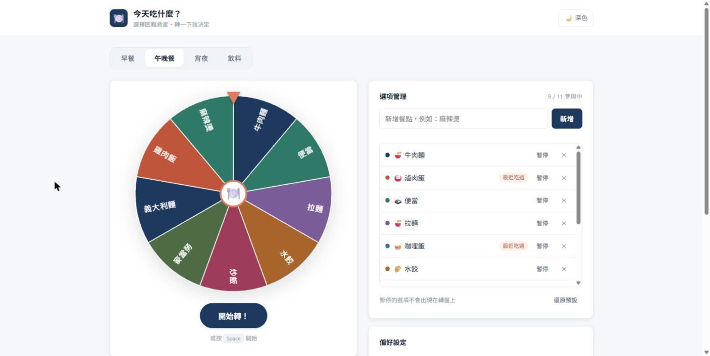
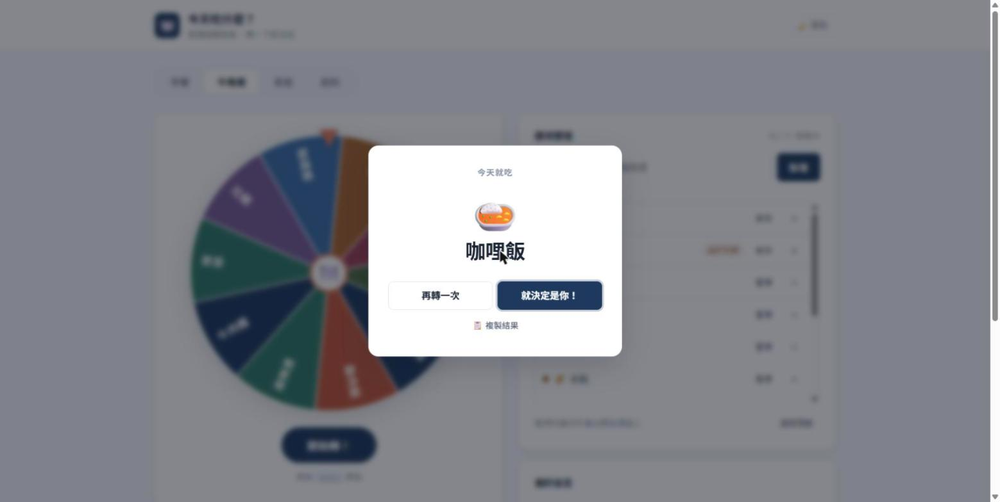
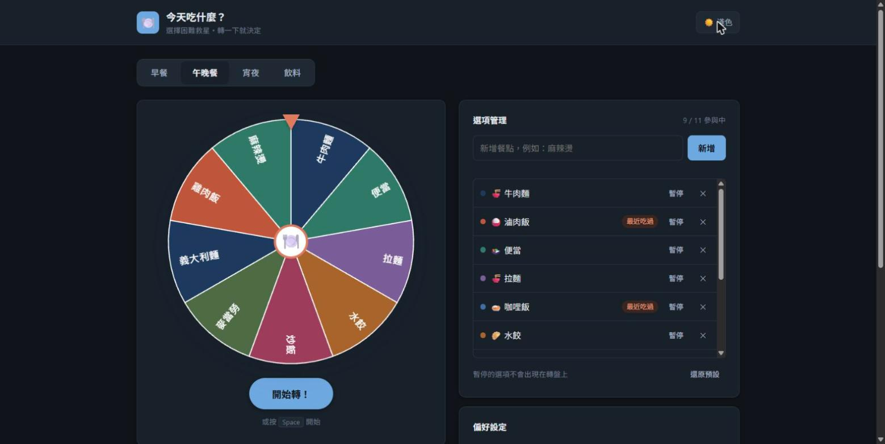
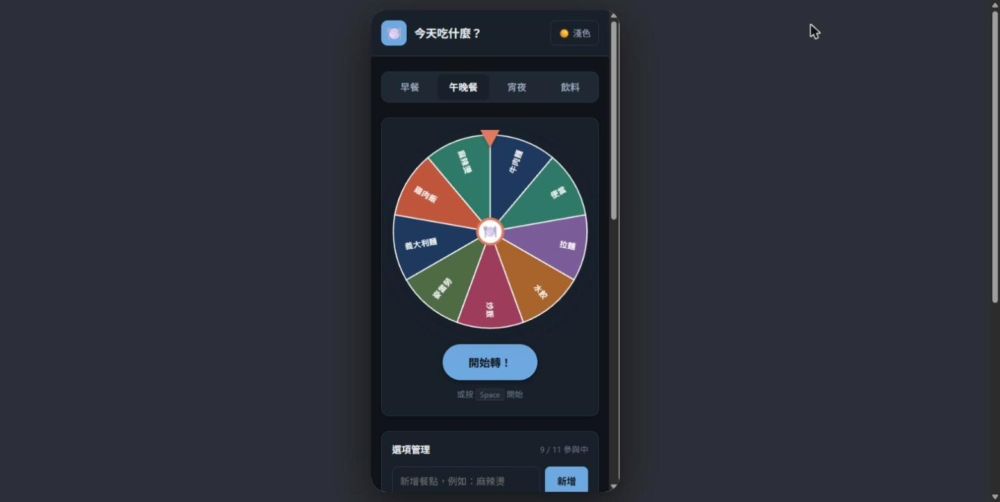

# 🍽️ 今天吃什麼？What to Eat

選擇困難救星：動畫轉盤幫你決定今天吃什麼，還會自動避開最近吃過的。

**👉 線上體驗：https://curtis618.github.io/what-to-eat/**

## 功能

- 🎡 **動畫轉盤**：canvas 繪製、自然減速，按 `Space` 也能轉
- 🗂️ **情境分頁**：早餐／午晚餐／宵夜／飲料
- ✏️ **選項管理**：新增、暫停、刪除、還原預設
- 🚫 **避開最近吃過**：最近 1～5 次決定過的餐點暫不參與
- 📊 **歷史紀錄**：最近 20 筆決定＋最常吃 Top 3
- 💾 **自動保存**：資料存在瀏覽器 localStorage
- 🌙 **深色模式**與📱 **手機版**

| 抽籤結果 | 深色模式 | 手機版 |
|---|---|---|
|  |  |  |

## 規格書

完整規格、驗收標準與開發修改紀錄請見 [spec.md](spec.md)。

---

生成式 AI 課程 HW1018・Vibe Coding 作業。單一 `index.html`，無外部相依套件。
